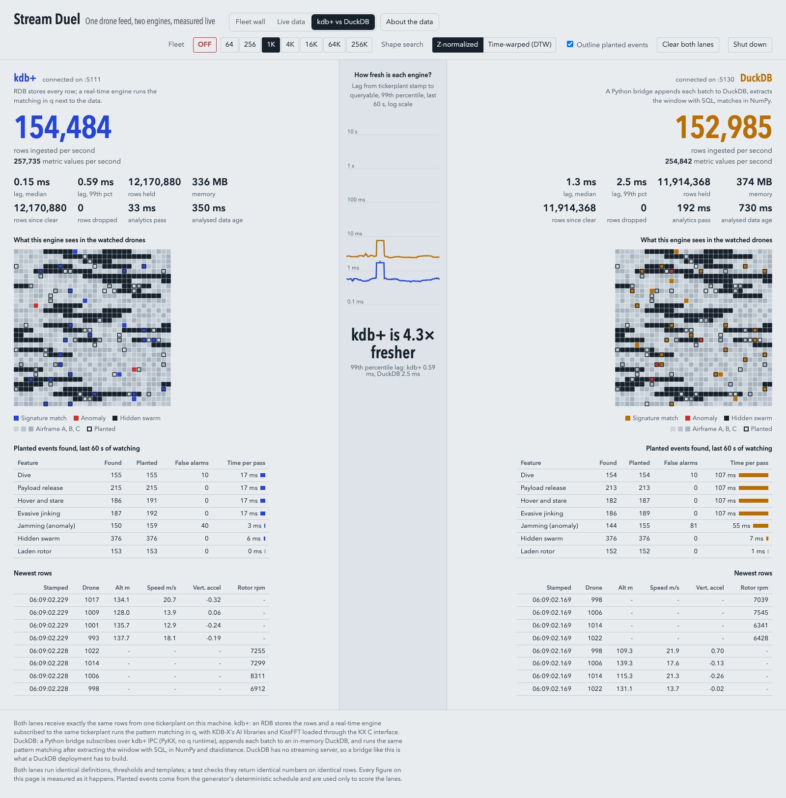
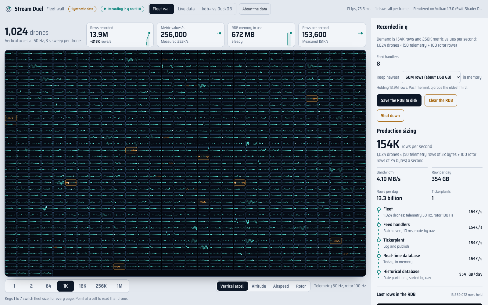
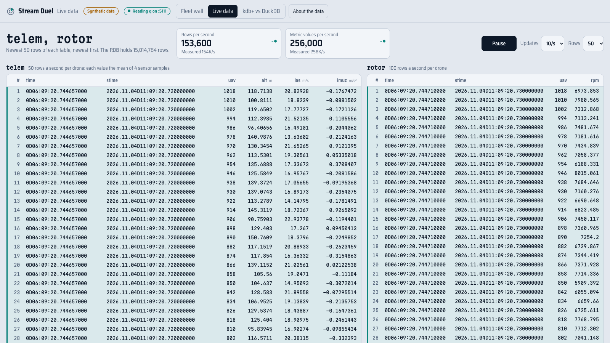

# Stream Duel

A synthetic drone fleet streams its telemetry through one kdb+ tickerplant, and three pages show
what happens to it. **Fleet wall** draws every drone live on the GPU. **Live data** shows the rows
as they arrive. **kdb+ vs DuckDB** runs two engines on the same feed: both ingest the same rows and
run the same real-time pattern matching, and every figure on the page is measured as it happens.
Built for an internal KX audience. All data is synthetic.



## Contents

- [The short version](#the-short-version)
- [Quick start](#quick-start)
- [The three pages](#the-three-pages)
- [Page 1: Fleet wall](#page-1-fleet-wall)
- [Page 2: Live data](#page-2-live-data)
- [Page 3: kdb+ vs DuckDB](#page-3-kdb-vs-duckdb)
- [What happens behind the pages](#what-happens-behind-the-pages)
- [The data](#the-data)
- [The pattern matching](#the-pattern-matching)
- [Measured results](#measured-results)
- [Pushing the fleet: what overload looks like](#pushing-the-fleet-what-overload-looks-like)
- [Being fair](#being-fair)
- [Configuration](#configuration)
- [Tests](#tests)
- [Troubleshooting](#troubleshooting)
- [Files](#files)
- [Glossary](#glossary)

## The short version

Up to 262,144 synthetic drones sense at 200 Hz. Each sends what the analysis needs, and no more:
- **telemetry** (altitude, airspeed, vertical acceleration) 50 times a second;
- **rotor speed** 100 times a second.

That is 150 rows and 250 measured values per drone per second. Everything goes through one kdb+
tickerplant to two lanes:

- **kdb+**: an RDB stores every row, and a real-time engine runs the pattern matching in q.
- **DuckDB**: a Python bridge appends every batch to an in-memory DuckDB, extracts the analysis
  window with SQL, and runs the same pattern matching in NumPy and dtaidistance.

At 1,024 drones (153,600 rows a second) on an Apple M4 Max:

| | kdb+ | DuckDB |
|---|---|---|
| Lag, tickerplant to queryable, 99th percentile | 0.4 ms | 2.9 ms |
| One analysis pass over all 1,024 drones | about 35 ms | about 185 ms |
| Planted events found | the same | the same |

Both lanes find the same events because they compute the same thing. A test runs both lanes' code
on the same rows and checks that every distance, score, correlation, group and frequency matches.
kdb+ is faster because of where and how the work runs, not because it does less.

## Quick start

You need:
- KDB-X: `q` on your PATH, or at `~/.kx/bin/q`;
- [uv](https://docs.astral.sh/uv/) for the DuckDB lane's Python;
- a C compiler. On macOS, run `xcode-select --install`, and `brew install libomp` for
  dtaidistance's parallel DTW.

```bash
./start.sh                    # builds the C libraries in lib/ if needed, starts every process
open http://localhost:5100    # the fleet wall; the bar at the top links to the other pages
./stop.sh                     # stops everything, the site too
```

The pages are at:

| Page | Address |
|---|---|
| Fleet wall | http://localhost:5100 (it goes to http://localhost:5100/fleet-wall.html) |
| Live data | http://localhost:5100/live-data.html |
| kdb+ vs DuckDB | http://localhost:5100/stream-duel.html |

`./start.sh` starts a small **launcher** (`launcher.py`, port 5100) that serves the pages and lets
them run `start.sh` and `stop.sh`. It keeps running after a page's **Shut down**, so the site stays
up and its **Start** button can bring everything back. It listens on this machine only. It serves the
three pages and `common.js` and nothing else from the folder. It answers only requests addressed to
localhost, and runs the scripts only for a page opened from localhost or from a file.

The pages are plain HTML files with no build, so you can also open them straight from the folder
(`open stream-duel.html`). Either way, they connect to the running processes by themselves.

| To | Do |
|---|---|
| Stop the drones but keep everything running | **OFF** (red, key `0`) on the duel page |
| Change the fleet | a fleet size on any page; every page follows |
| Stop every process but the launcher (the site stays up) | **Shut down** on any page (click twice) |
| Start everything again from a page | **Start**, or on the duel page any fleet size |
| Stop every process, the launcher and its site too | `./stop.sh`. A page left open shows the command to start again. |
| Start every process from a terminal | `./start.sh` |

## The three pages

Every page has the same bar at the top: **Fleet wall | Live data | kdb+ vs DuckDB**, and
**About the data**. All three show the same running system. The fleet is one setting: change it on
any page and the others follow within a second.

**About the data** opens a popup on any page. It shows:
- what each drone sends and what every column means;
- why the two rates are what they are;
- what the rates save per drone, against sending all four metrics at 200 Hz;
- what the current fleet sends a second;
- why four metrics is the minimum.

Its figures are the ones in [The data](#the-data).

## Page 1: Fleet wall



The wall draws every drone in the fleet as its own small live chart, all in one GPU draw call, up
to a million drones. It doesn't stream the data into the browser. The GPU runs the same seeded
formulas as the q feed handlers (`gen.q`), down to the hash, including:
- the planted events, coordinated groups and airframe classes;
- the two rates: each telemetry point is the mean of four sensor samples, each rotor point every
  second sample.

So each trace is the series q records for that drone. A test-style check shows the page's
JavaScript and q's rows agree to within q's 32-bit float storage (0.0005 rpm, 0.00001 m) across a
slot with every kind of event.

| Part | What it shows |
|---|---|
| Drone count | How many drones the wall draws: the fleet q is running, or the one you pick. |
| The four tiles | From the q RDB, every 250 ms: **Rows recorded** since start or Clear; **Metric values/s**, what the fleet sends (drones × 250) with the measured rate under it; **RDB memory in use**; **Rows per second**, what the fleet sends (drones × 150) with the measured rate under it. A measured line turns amber when q gets less than 90% of what's sent. Each tile has a 60 s sparkline. |
| The wall | One card per drone. At 1 or 2 drones, all four channels; otherwise the channel you pick, as a 3 s sweep. With more drones than fit as charts, each drone is one cell coloured by its live value. Amber cards are drones in a vibration alert (telemetry-kit's alerts, about 0.6% of drones at a time). |
| Fleet buttons | 1, 2, 64, 1K, 16K, 256K or 1M drones (keys `1`–`7`). This sets the fleet for every page. |
| Channel buttons | Vertical acceleration, altitude, airspeed (50 Hz) or rotor (100 Hz). |
| Hover | Point at a drone to read its latest row in each q table, with the sample times. Without q, the page computes the values itself and says so. |
| Recorded in q | What the fleet sends, the number of feed handlers, **Keep newest** (the RDB's row limit; past it, each table keeps its newest two thirds), **Save the RDB to disk** (both tables to `hdb/<date>/`, sorted, `p#` on `uav`), **Clear the RDB**, **Shut down**. When nothing is running, **Start**. |
| Production sizing | For the fleet on the wall: rows a second, bandwidth, raw data per day, rows per day, and the tickerplant shards it would take at about 2M rows a second each. A planning figure. |
| Tap | The newest rows in the RDB from both tables, a dot where a row doesn't carry a value. |
| Query it from q | Snippets for a q session on this machine, including an as-of join of the two tables. |

The wall needs WebGL2: a current Chrome, Edge, Safari or Firefox. It loads two Google Fonts and
falls back to system fonts offline.

## Page 2: Live data



The newest rows of `telem` and `rotor`, side by side, newest first, straight from the RDB:
- up to 30 updates a second; rows that arrived since the last update are tinted;
- **Pause** (or the space bar) freezes the tables;
- **Updates** sets the pace, **Rows** sets how many to show (25, 50 or 100).

The two tiles are rows and metric values per second: what the fleet sends, with the measured rate
under each. The page only reads; it never changes the fleet.

## Page 3: kdb+ vs DuckDB

The page has three columns. The **kdb+ lane** is on the left and the **DuckDB lane** on the right;
both are laid out the same way. **How fresh is each engine?** sits between them.

### The header

| Control | What it does |
|---|---|
| **Fleet** | **OFF** stops the drones: no rows are generated, both lanes keep running and keep what they stored. **64** to **256K** set how many drones fly: 9,600 to 39.3 million rows a second. Keys `0` to `7` do the same. Drones 1 to 1,024 are the *watched* drones: they carry the planted events and are analysed. |
| **Shape search** | How both lanes search for the four signature manoeuvres. **Z-normalized** compares shapes point by point after scaling (time series search). **Time-warped (DTW)** also matches a manoeuvre flown faster or slower, and costs more. Each mode has its own thresholds. |
| **Outline planted events** | Outlines every drone in the grids that has a planted event in progress (see below). |
| **Clear both lanes** | Deletes every stored row in both lanes and restarts the page's scoring. Click twice within 3 s: the first click arms it. |
| **Shut down** / **Start** | **Shut down** stops every process (feed handlers, tickerplant, both lanes) through the launcher, which force-stops anything stuck. Click twice within 3 s. The button then turns into a green **Start**, which starts everything again; picking a fleet size does the same and flies that size. If the launcher isn't running either (after `./stop.sh`), the button is greyed out and the page shows the command to run. |

### Each lane

**Name and connection.** "connected on :5111" (kdb+) or ":5130" (DuckDB) while the page's websocket
to that lane is open. If the lane isn't running, it says "not running on :5111" in red. Its last
figures are greyed out, since they're no longer live, and the page retries every 2 s.

**The big number: rows ingested per second.** Rows the lane stored in the last 250 ms, both tables,
as a rate, smoothed: each update moves 40% of the way to the new value. With the feed keeping up,
it matches the fleet: 1,024 drones × 150 = 153,600.

**Metric values per second.** The line under it: measured values the lane stored a second, 3 per
telemetry row and 1 per rotor row. At 1,024 drones, about 256,000.

**The eight figures**, updated every 250 ms (ingest) and every second (analysis):

| Figure | What it means | How it's measured |
|---|---|---|
| **lag, median** and **lag, 99th pct** | How long a row takes from the tickerplant stamping it to being queryable in this engine | Each batch's lag is the time from its tickerplant stamp to the moment it's in the store: in the kdb+ RDB, right after the insert; in DuckDB, after the insert commits. Median and 99th percentile are weighted by rows, over the batches of the last 5 s. Both lanes use the same clock (same machine). |
| **rows held** | Rows in memory now, both tables | When a lane passes 60 million rows, each table keeps its newest two thirds. At 1,024 drones that first happens after about 6.5 minutes. |
| **memory** | Memory the store uses | kdb+: the RDB's heap in use (`.Q.w[]`). DuckDB: DuckDB's own memory (`duckdb_memory()`). q grows vectors in power-of-two blocks, so its figure can run up to about a quarter above the raw column size. |
| **rows since clear** | Rows stored since the lane started, or since **Clear both lanes** | A counter in each lane. |
| **rows dropped** | Rows the tickerplant had to skip for this lane | When more than 256 MB is already waiting to be sent to a lane, the tickerplant skips that lane for the batch and counts the rows. The count runs from the tickerplant's start; Clear doesn't reset it. Red when above 0. |
| **analytics pass** | How long the newest analysis pass took | Window extraction plus the four features (signatures, anomaly, swarm, rotor), in ms. |
| **analysed data age** | How old the newest analysed sample was when the result was shown | Now, minus the sample time of the newest sample in the latest pass's window. It adds up lag, the wait for the next pass (passes run every second) and the pass itself. Red above 3 s. |

### What this engine sees in the watched drones

A 32 × 32 grid: one cell per watched drone, drone 1 at the top left, read left to right. Each lane
colours the cells from its own latest analysis pass. If a drone has several findings, the first
colour in this list wins:

| Colour | Meaning |
|---|---|
| Red | **Anomaly**: the drone's newest half second of vertical acceleration has no close match anywhere earlier in its window (planted as jamming). |
| Lane colour (blue for kdb+, amber for DuckDB) | **Signature match**: the drone flew one of the four manoeuvres (dive, payload release, hover and stare, evasive jinking). |
| Black | **Hidden swarm**: the drone belongs to a group of three or more whose altitude and airspeed changes move in lockstep. |
| Three greys | **Airframe class A, B or C**, from the lane's rotor analysis (dominant rotor frequency 11, 17 or 23 Hz). Before a lane's first pass, the generator's class. |
| Outline | **Planted**: an event is in progress on this drone (or ended less than 1 s ago) at the time of the lane's newest analysed sample. Laden rotors aren't outlined. Toggle with **Outline planted events**. |

The two grids should look nearly the same. Small differences come from timing: each lane analyses
a slightly different instant.

### Planted events found, last 60 s of watching

The generator plants events on a deterministic schedule (see [The data](#the-data)). The real-time
engine lists the events of the last 60 s for the page, and the page scores each lane's reports
against them. Neither lane's analysis ever sees this list.

| Column | Rule |
|---|---|
| **Planted** | Events of that kind that ended more than 2 s before the lane's newest analysed sample and started in the last 60 s, since the page began watching (or since Clear). They must also last long enough for the feature to see: a laden period at least 2.56 s (the rotor analysis uses 256 samples at 100 Hz), a swarm slot at least 4 s (the window). For swarms, each member drone counts as one event. |
| **Found** | Planted events the lane reported: the same drone and feature, at a time from 1 s before the event started to 4.5 s after it ended. A signature report's time is where the match starts in the window; other reports use the pass's newest sample time. |
| **False alarms** | Reports from the last 60 s with no planted event of that feature on that drone from 1.5 s before it started to 4.5 s after it ended. An anomaly is a false alarm only if nothing at all was planted on that drone at the time. Repeats of the same drone and feature within about 4 s count once. |
| **Time per pass** | The feature's time in the latest pass. The four signature rows share one time: one search covers all four. The bars use one scale across both lanes. |

### Newest rows

The last 4 rows each lane stored from each table, newest first: the tickerplant's stamp (time of
day), drone id, altitude (m), airspeed (m/s), vertical acceleration (m/s²) from `telem`, rotor speed
(rpm) from `rotor`. A dash marks a value the row's table doesn't carry.

### How fresh is each engine?

The middle column plots both lanes' 99th-percentile lag for the last 60 s, on one log scale from
0.1 ms to 10 s. Below it, the verdict divides the two current 99th percentiles ("kdb+ is 6.8×
fresher") and shows both. Otherwise it says what state the system is in:

| Verdict | When |
|---|---|
| Connecting… | the first 2.5 s after the page opens |
| Starting… / Stopping… | the launcher is running `start.sh` or `stop.sh` |
| Stopped | no lane is running, and the launcher is: press **Start** or pick a fleet size |
| Not running | neither the lanes nor the launcher are running: the page shows the `./start.sh` command |
| Start failed | `start.sh` failed; the page shows its last line, and `logs/` has the rest |
| Feed off | the fleet is OFF |
| Waiting for both lanes | the lanes are up but haven't both reported lag yet |

**Several pages at once.** Every open page shows the fleet and mode the lanes are running, whoever
set them. A page sends its own fleet and mode only when you click, or when it started the system.
The RDB's fleet is the one flying, because it drives the feed handlers. If the DuckDB lane ever
disagrees with it, the page brings it into line.

### The footer

Two paragraphs on the page say how each lane is built and that every figure is measured live. A
viewer can check the comparison's terms without leaving the page.

## What happens behind the pages

```text
   feed handlers fh.q × 8      (gen.q: 200 Hz sensor, planted events; every 10 ms, the blocks that ended)
                 │  async, then one sync call per tick (never runs ahead of the tickerplant)
            tickerplant tp.q   (telem and rotor; stamps each batch; per-subscriber queue limit, drops counted)
       ┌─────────┼──────────────────────────────┐
  rdb.q :5111   rte.q :5112                 bridge/ :5130 (Python)
  kdb+ RDB      kdb+ real-time engine       PyKX subscription → queue → ingest thread → DuckDB
  stores both   watched drones only,        lag after commit; analysis thread: SQL window,
  tables, stats analysis every second       NumPy, dtaidistance (DTW in a worker process)
       │  websocket   │ results via the RDB         │  websocket
       └──────────────┴── the pages (served by launcher.py :5100) ───┘
```

The life of one row:

1. **Sensed and sent.** Each feed handler owns the drones whose id modulo the number of feed
   handlers is its shard (8 by default). It runs each drone's 200 Hz sensor (`gen.q`'s `sigDuel`),
   in 20 ms blocks of 4 samples. Every 10 ms it builds the rows for every block that has ended
   (`gen.q`'s `blockRows`), per drone:
   - one `telem` row: the mean of the block's 4 samples of altitude, airspeed and vertical
     acceleration;
   - two `rotor` rows: rotor speed at samples 0 and 2.

   It sends both tables to the tickerplant, then makes one synchronous call, so it can never run
   ahead of what the tickerplant has taken. If it falls more than 0.5 s behind, it skips the
   oldest blocks to stay current; those rows are never generated and no lane sees them.
2. **Stamped and published.** The tickerplant adds a `time` column (time of day) to each batch and
   publishes it. The kdb+ RDB and the DuckDB bridge each get every row of both tables. The
   real-time engine gets only drones 1 to 1,024 (`.u.subw`, kdb+tick's filtered subscription). If
   more than 256 MB is already queued for a subscriber, the tickerplant skips it for this batch and
   counts the dropped rows for that lane.
3. **Stored, kdb+ lane.** The RDB inserts the batch into `telem` or `rotor`, in memory, and records
   its lag. Every 250 ms it sends every page its stats: rates, lag, rows, memory, drops and the
   newest rows. It also answers the pages' requests: newest rows, a drone's latest rows, save,
   clear, fleet.
4. **Stored, DuckDB lane.** The bridge reads the batch over kdb+ IPC with PyKX (no q runtime in the
   bridge), turns it into NumPy columns and queues it. An ingest thread drains the queue into one
   `INSERT` per table into an in-memory DuckDB with the same schema, then records the lag. The
   bridge sends the duel page the same stats every 250 ms. If more than 4 million rows are waiting
   for the ingest thread, the bridge stops reading, and the tickerplant drops and counts rows for it.
5. **Analysed.** Once a second, on a fixed schedule:
   - The kdb+ real-time engine runs `analytics.q` on the watched drones' newest seconds, using 8
     secondary threads. It sends the result to the RDB, which forwards it to the pages.
   - The bridge runs `bridge/analytics.py` on a worker thread. Two SQL queries extract the newest
     4.5 s of the watched drones from both DuckDB tables. DTW runs in a separate worker process
     (see [Being fair](#being-fair)).
6. **Shown.** The pages receive stats, results and the planted list as JSON over websockets and draw
   everything on canvas or the GPU.

The message formats are in [DESIGN.md](DESIGN.md).

### Processes and ports

| Process | Port | Lane | Job |
|---|---|---|---|
| `fh.q` × 8 | 5120-5127 | both | Feed handlers |
| `tp.q` | 5110 | both | Tickerplant |
| `rdb.q` | 5111 | kdb+ | RDB; the websocket for the wall, Live data and the duel's kdb+ lane |
| `rte.q` | 5112 | kdb+ | Real-time engine |
| `bridge/` | 5130 | DuckDB | Bridge and DuckDB; the duel page's websocket for the DuckDB lane |
| `launcher.py` | 5100 | | Serves the pages at http://localhost:5100 and lets them run `start.sh` and `stop.sh` (localhost only) |

## The data

Each drone senses at 200 Hz and sends two tables, at the rates the analysis needs.

**`telem`**: 50 rows a second per drone, 32 bytes each.

| Column | What it is | Type | Bytes |
|---|---|---|---|
| `time` | tickerplant stamp: when the row entered the pipeline | timespan | 8 |
| `stime` | sample time: the start of the row's 20 ms | timestamp | 8 |
| `uav` | drone id | int | 4 |
| `alt` | altitude, m: the mean of the 4 sensor samples in the 20 ms | real | 4 |
| `ias` | airspeed, m/s: the mean, likewise | real | 4 |
| `imuz` | vertical acceleration, m/s²: the mean, likewise | real | 4 |

**`rotor`**: 100 rows a second per drone, 24 bytes each.

| Column | What it is | Type | Bytes |
|---|---|---|---|
| `time` | tickerplant stamp | timespan | 8 |
| `stime` | sample time | timestamp | 8 |
| `uav` | drone id | int | 4 |
| `rpm` | rotor speed: every second sensor sample | real | 4 |

**Why these rates.**
- **Telemetry, 50 Hz.** The analysis works on 50 Hz telemetry: shapes as fast as a 3 Hz jink,
  half-second anomalies, 4-second windows. Averaging 4 samples on the drone is the filter a sensor
  applies before it sends fewer samples, so nothing the analysis uses is lost.
- **Rotor, 100 Hz.** The rotor's signature lives between 5 and 40 Hz, which needs more than 80
  samples a second. At 100 Hz, 256 samples (2.56 s) tell frequencies 0.39 Hz apart: enough to tell
  a 17 Hz rotor from the same rotor laden, 8% slower at 15.6 Hz.

**Per drone, per second:**

| | All 4 metrics at 200 Hz | What each drone sends | Saved |
|---|---|---|---|
| Rows | 200 | 150 | 25% |
| Metric values | 800 | 250 | 69% |
| Bytes | 7,200 | 4,000 | 44% |

**By fleet size:**

| Fleet | Rows a second | Metric values a second | Data a second |
|---|---|---|---|
| 64 | 9,600 | 16,000 | 0.26 MB |
| 1K | 153,600 | 256,000 | 4.1 MB |
| 16K | 2.46M | 4.1M | 66 MB |
| 64K | 9.8M | 16.4M | 262 MB |
| 256K | 39.3M asked | 65.5M asked | 1.05 GB asked |

**Four metrics is the minimum.** Each one is the only source for at least one feature:

| Metric | Used by | Without it |
|---|---|---|
| `alt` | dive, swarm | dives lose their main shape (the altitude drop), and swarm detection is left with one channel. One channel lets chance correlations among a thousand drones form false groups. |
| `ias` | dive, hover and stare, swarm | hover and stare is lost (its only channel); dives and swarms weaken as above |
| `imuz` | payload release, evasive jinking, jamming | all three are lost |
| `rpm` | airframe class, laden rotor | both are lost |

Of the identifiers, the drone id and sample time are essential. The tickerplant stamp is what lag
is measured from.

### The drones and the planted events

The signals come from telemetry-kit's generator, `gen.q`. They are smooth, with per-drone
randomness, and deterministic: the same drone at the same time always has the same values.

Everything planted is a hash of the drone id and the time slot, so the feed handlers (which plant
the events), the scoring list (which reports them) and the wall (which draws them) always agree.
Sample time wraps every 1,024 s and is cut into 16 s slots. In each slot, each watched drone has
about a 1 in 4 chance of one event, starting 2 to 12 s into the slot:

| Event | Lasts | What the drone does | Found by |
|---|---|---|---|
| Dive | 3 s | altitude drops about 45 m and recovers while airspeed rises | signature, on altitude and airspeed |
| Payload release | 1 s | flies laden (rotor 8% slower) until release, then a jolt that rings down at 2.5 Hz while the rotor speeds up | signature, on vertical acceleration; the laden period by the rotor |
| Hover and stare | 5 s | airspeed falls to about 1 m/s and holds; altitude steadies | signature, on airspeed |
| Evasive jinking | 3 s | 3 Hz vertical oscillation with an airspeed wobble | signature, on vertical acceleration |
| Jamming | 2 s | broadband noise on every channel | anomaly |
| Hidden swarm | 16 s | watched drones form groups of six consecutive ids; in about 1 slot in 5 a group flies coordinated, with all six following one altitude and airspeed waveform | swarm |
| Airframe class | always | each drone's class (A, B or C, from its id) sets its rotor frequency: 11, 17 or 23 Hz | rotor |

## The pattern matching

Both lanes do exactly this, with the same definitions (`analytics.q` and `bridge/analytics.py`),
the same templates (`templates.json`) and the same thresholds (`config.json`).

**The window.** Each pass takes the newest 4 s of every watched drone's telemetry (200 rows at
50 Hz) and its newest 256 rotor samples (2.56 s at 100 Hz). Every drone's window ends at the same
instant: the newest sample time all watched drones have reached. Feed handlers publish a few
milliseconds apart, and drones shifted against each other by even one row would no longer
correlate as a swarm. If the window is shorter than the longest template (the feed skipped
samples), the pass reports "short" instead of analysing it.

| Feature | What it computes | Threshold | kdb+ lane | DuckDB lane |
|---|---|---|---|---|
| **Signatures** | For each drone and each of the 4 templates, the best match anywhere in the window, per channel, z-normalized; the distance is averaged over the template's channels and divided by √(template length). The drone's best signature is reported if under its threshold. | per signature and mode (`config.json`) | `.ai.tss.tss` or `.ai.dtw.search` (KDB-X AI libraries), `peach` over drones | NumPy sliding z-normalized distance, or dtaidistance DTW with KDB-X's definition (C, OpenMP), in a worker process |
| **Anomaly** | Distance from the newest 0.5 s of vertical acceleration to its nearest match earlier in the window (a discord score) | 4.54 | `.ai.tss.tssdist`, `peach` over drones | NumPy, the same distance |
| **Swarm** | Correlation of every pair of drones' altitude changes, and of their airspeed changes; pairs above 0.99 on both are linked, and connected groups of 3 or more are reported | 0.99, at least 3 drones | one matrix product (the Gram matrix) through the platform BLAS, called from q with the KX C API (`lib/kxblas.so`; Apple Accelerate on macOS) | NumPy matrix product (Accelerate on macOS) |
| **Rotor** | Dominant rotor frequency between 5 and 40 Hz over the newest 256 samples, refined between FFT bins; nearest of 11, 17, 23 Hz or the same × 0.92 (laden) | nearest frequency | KissFFT called from q with the KX C API (`lib/kxfft.so`), one call per thread's share of the drones | `numpy.fft` |

The templates come from the same formulas the generator uses to plant the events
(`tools/templates.q`). The thresholds come from `tools/calibrate.q`. It generates 96 s of 256
drones exactly as the feed handlers do, slides the window along them every second, and labels every
drone-window from the planted schedule. For each signature it picks the threshold with the best F1
score; for the anomaly, the best recall with precision of at least 0.97. The swarm and rotor rules
are fixed. The results, the same before and after the move to two rates:

| | Precision | Recall |
|---|---|---|
| Dive / payload / hover / jink (z-normalized) | 0.98 / 1 / 1 / 1 | 0.99 / 0.96 / 1 / 1 |
| Dive / payload / hover / jink (DTW) | 0.98 / 1 / 1 / 1 | 1 / 0.96 / 1 / 1 |
| Anomaly, per drone-window | 0.97 | 0.72 |
| Swarm members | 1 | 0.9 |
| Rotor class | accuracy 1 on drones without events | |

## Measured results

Apple M4 Max (16 cores, 128 GB), 8 feed handlers, `THREADS=8`, the commit this README ships with.

**Lag by fleet size** (steady state: medians of 30 one-second samples after 15 s at each size):

| Fleet | Rows a second | kdb+ lag p50 / p99 | DuckDB lag p50 / p99 | Rows dropped |
|---|---|---|---|---|
| 1K | 0.15M | 0.12 / 0.39 ms | 1.5 / 2.9 ms | none |
| 4K | 0.61M | 0.18 / 0.66 ms | 1.7 / 3.5 ms | none |
| 16K | 2.5M | 0.70 / 2.6 ms | 2.5 / 10.4 ms | none |
| 64K | 9.8M | 0.57 / 11 ms | 5.9 / 50 ms | none |
| 256K | 39.3M asked, 21M produced | 424 / 547 ms | 364 / 533 ms | 1.4-2.2M a second for each lane |

Up to 64K drones both lanes keep up with every row. kdb+'s 99th-percentile lag stays 4 to 7 times
lower, and its median 4 to 13 times lower. At 256K the shared pipeline is the limit, not either
engine (see [Pushing the fleet](#pushing-the-fleet-what-overload-looks-like)).

**One analysis pass over 1,024 drones** (204,800 telemetry and 262,144 rotor samples), on a quiet
machine:

| | kdb+ | DuckDB |
|---|---|---|
| Whole pass, z-normalized | about 35 ms | about 185 ms |
| Window extraction | about 8 ms | about 21 ms |
| Signatures | 17 ms | 108 ms |
| Anomaly | 3 ms | 47 ms |
| Swarm | 6 ms | 7 ms |
| Rotor | under 1 ms | 1 ms |
| Whole pass, DTW | about 255 ms | about 350 ms |
| Signatures, DTW | 239 ms | 270 ms |

DTW is close because both lanes run compiled DTW on the same 8 threads; nearly all the time is
inside the DTW search itself. With DTW on, DuckDB's p99 lag is about 2.6 ms; kdb+'s about 0.5 ms.
Anything else busy on the machine slows both lanes. For example, with the GPU wall open in a
browser, passes run about 50-75 ms and 210 ms.

**Events found at 1,024 drones** (both lanes, from the page, two runs of 60 s):

| Feature | Found | False alarms a minute |
|---|---|---|
| Dive | 99-100% | 16-23 |
| Payload release | 100% | 9-29 |
| Hover and stare | 97-98% | 0 |
| Evasive jinking | 99% | 2-3 |
| Jamming (anomaly) | 94-97% | 68-144, out of about 61,000 drone analyses a minute |
| Hidden swarm | 100% | 0-2 |
| Laden rotor | 100% | 0-4 |

The two lanes' figures differ by a few events: each lane analyses a slightly different instant,
and an event at the edge of a window can fall either way. Most false alarms are drones with nothing
planted whose own signal briefly looks like a manoeuvre. The same drones recur, because the signal
schedule repeats every 1,024 s, so counts move with the schedule.

## Pushing the fleet: what overload looks like

Everything runs on one laptop: 8 feed handlers generating the data, one tickerplant fanning it out,
and both lanes.

- **Up to 64K drones (9.8M rows a second)** everything keeps up. No rows are dropped, and the lag
  figures are the engines' own.
- **At 256K drones (39.3M rows a second asked)** the feed handlers produce only about 21M rows a
  second and skip the rest to stay current. The tickerplant drops 1.4-2.2M rows a second for each
  lane, and both lanes lag about half a second. The kdb+ RDB uses well under one core while this
  happens: the limit is upstream of both engines.

What the page shows then:
- **rows dropped** turns red and climbs in both lanes;
- **lag** reaches about half a second in both;
- **analysed data age** climbs in both. The skipped samples leave gaps, so a window holds less than
  the 3 s the longest signature template needs, and both lanes report a short window instead of
  analysing it.

Use 64K to compare the engines, and 256K to show the ceiling of the pipeline on one machine.
**OFF** stops the drones at once, and the queues drain within seconds.

kdb+'s real-time engine subscribes to the watched drones only, so the tickerplant never drops its
rows even when the stores lose rows. The DuckDB lane analyses its own store, so it loses whatever
the tickerplant drops for it.

## Being fair

The comparison is only worth showing if it's fair. Everything below is deliberate.

- **Same input.** Same rows, from the same tickerplant, on the same machine, with the same
  definitions, templates and thresholds. A test (`tests/test_crosscheck.py`) runs the DuckDB lane's
  code on the rows the kdb+ lane analysed and checks every number matches.
- **A real bridge.** DuckDB has no streaming server, so the bridge is what a DuckDB deployment has
  to build. The page says so in each lane's description and in the footer.
- **Neither lane's analysis blocks its ingest.** kdb+ runs its analysis in a separate real-time
  engine, as kdb+tick does. The DuckDB lane runs its analysis on its own thread, and DTW in a
  separate worker process: dtaidistance holds Python's GIL while it computes, and DuckDB's inserts
  need the GIL. In the bridge's own process, DTW raised the bridge's p99 lag from 2 ms to 16 ms.
- **Same threads.** Each lane's analysis gets 8 threads (`THREADS`): the kdb+ engine's secondary
  threads, and dtaidistance's OpenMP threads. kdb+ also spreads FFTs over its threads with `peach`;
  NumPy has no built-in parallelism for those and runs them on one thread.
- **Same matrix library.** Both lanes compute the swarm correlations with Apple Accelerate's BLAS:
  NumPy links it on macOS, and the kdb+ lane calls it through the KX C API. q's own `mmu` took
  24 ms for that product, against 2 ms in Accelerate. On Linux the build uses OpenBLAS or another
  CBLAS; without one, q falls back to `mmu` spread over threads.
- **Same schedule and windows.** Both lanes analyse once a second on a fixed schedule, and both end
  every drone's window at the same instant.
- **Overload is counted, not hidden.** A lane that falls behind gets its rows dropped and counted
  by the tickerplant; the page shows the count. The bridge yields after every batch, so it keeps
  reporting even when the tickerplant always has data waiting for it. An earlier version didn't:
  under overload it went silent, and the page showed DuckDB's last numbers as if they were live.
- **Lag is measured in steady state.** Right after a restart, q is still growing its memory and its
  first trims run slower, which briefly lifts its lag. The figures above are from a warm system.

## Configuration

`./start.sh` reads these environment variables:

| Variable | Default | What it sets |
|---|---|---|
| `SHARDS` | CPU cores − 6, between 1 and 8 | number of feed handlers |
| `THREADS` | 8 | analysis threads for each lane: the kdb+ engine's secondary threads and the DuckDB lane's OpenMP threads |
| `MAXROWS` | 60,000,000 | rows each lane keeps before each table trims to its newest two thirds |
| `Q` | `q`, else `~/.kx/bin/q` | the q binary |

`config.json` holds what both lanes share:
- watched drones (1,024), the window (4 s), the telemetry rate (`ana_hz`, 50) and the pass interval
  (1,000 ms);
- the default shape search and the DTW warping window (10%);
- every threshold, the anomaly window (0.5 s), and the swarm channels and minimum group size;
- the rotor's rate (100 Hz), FFT length (256), band, class frequencies and laden factor.

The rates the drones send at are in `gen.q` (`SENSORHZ`, `TELEHZ`, `ROTORHZ`); a test checks
`config.json` agrees. After changing `config.json`, regenerate the cross-check fixture (see
[Tests](#tests)).

The tickerplant's queue limit is `-maxq` in MB (default 256). With `-log 1` it also writes a log
you can replay with `-11!`.

## Tests

```bash
q tests/test_fft.q && q tests/test_blas.q && q tests/test_gen.q   # the C libraries and the generator
uv run pytest                              # the cross-check, the DuckDB store and the launcher
q tools/calibrate.q -s 8                   # precision and recall of every feature against planted events
```

After changing `analytics.q`, `gen.q`, `config.json` or `templates.json`, regenerate the
cross-check fixture with `q tools/fixture.q -s 4`.

## Troubleshooting

| You see | Do this |
|---|---|
| http://localhost:5100 doesn't load | The launcher isn't running: run `./start.sh`. Or open the HTML files straight from the folder. |
| "not running on :5111" or ":5130" | Press **Start** on a page; if it's greyed out, run `./start.sh`. |
| Picking a fleet size after **Shut down** does nothing | The launcher isn't running (you ran `./stop.sh`, or started with an older `start.sh`). Run `./start.sh` once; from then on the pages can start everything. |
| `./start.sh` fails with "address already in use" | Run `./stop.sh` first. It stops anything left from a previous run, and force-stops any process that hasn't exited after 5 s. |
| The fleet changes by itself | Another tab has an older copy of a page, which sets its own fleet whenever it reconnects. Reload or close it. |
| No bar of page links, or an old layout | Reload the page: the tab has an old copy. |
| **rows dropped** stays high after you lower the fleet | It counts from the tickerplant's start. Restart (`./stop.sh`, `./start.sh`) to reset it. |
| **analysed data age** red at 256K | The feed handlers are skipping samples and windows are too short to analyse (see [Pushing the fleet](#pushing-the-fleet-what-overload-looks-like)). Lower the fleet. |
| The wall is blank or says it needs WebGL2 | Use a current Chrome, Edge, Safari or Firefox. |

Each process logs to `logs/` (`tp.log`, `fh0.log` …, `rdb.log`, `rte.log`, `bridge.log`,
`launcher.log`).

## Files

| Path | What it is |
|---|---|
| `fleet-wall.html`, `live-data.html`, `stream-duel.html` | the three pages |
| `common.js` | what the pages share: the bar of page links, the About the data popup, the launcher client |
| `schema.q` | the two tables, `telem` and `rotor` |
| `gen.q` | telemetry-kit's signal generator plus planted events, airframe classes and groups (`sigDuel`), the two rates (`blockRows`), and `planted[]`, which lists the events for scoring |
| `fh.q`, `tp.q` | feed handlers and the tickerplant (ports 5120+, 5110) |
| `rdb.q`, `rte.q`, `analytics.q` | the kdb+ lane: storage, stats and the pages' websocket (5111), real-time engine (5112), the pattern matching |
| `c/kx_fft.c`, `c/kx_blas.c`, `c/build.sh` | KissFFT and the platform BLAS exposed to q through the KX C API (`lib/kxfft.so`, `lib/kxblas.so`) |
| `bridge/` | the DuckDB lane (5130): `server.py` (subscription, websocket), `store.py` (DuckDB), `analytics.py` (the pattern matching) |
| `launcher.py` | serves the pages and lets them start and stop everything (port 5100, localhost only) |
| `config.json`, `templates.json` | shared settings, thresholds and signature templates |
| `tools/templates.q`, `tools/calibrate.q`, `tools/fixture.q` | write the templates, choose thresholds against planted truth, write the cross-check fixture |
| `start.sh`, `stop.sh` | start and stop every process (`stop.sh --keep-launcher` leaves the launcher running) |
| `tests/` | the cross-check, the DuckDB store, the launcher, the C libraries, the generator |
| `DESIGN.md` | the contract the lanes and the pages follow, including message formats |

## Glossary

| Term | Meaning |
|---|---|
| Feed handler | A process that produces data and sends it to the tickerplant. Here it generates synthetic drones. |
| Tickerplant | The kdb+ process every update goes through: it stamps each batch and publishes it to subscribers. |
| RDB | Real-time database: a kdb+ process that holds today's rows in memory. |
| Real-time engine (RTE) | A kdb+ subscriber that computes on the stream next to the data, so analysis never blocks the RDB. |
| Lag p50 / p99 | Median and 99th-percentile time from tickerplant stamp to queryable. p99 is the delay 99% of rows beat. |
| Z-normalization | Rescaling a series to mean 0 and standard deviation 1, so shapes compare regardless of level or size. |
| TSS | Time series (subsequence) search: find where a short shape best matches inside a longer series. |
| DTW | Dynamic time warping: a distance that lets one series stretch or compress in time to match another. |
| Discord | The part of a series least like anything else in it: the anomaly score here. |
| Gram matrix, BLAS | The matrix of all pairwise dot products; BLAS is the standard library interface for computing such products fast. |
| KX C API | The C interface for extending q: `2:` loads a C function into q. |
| `peach` | q's parallel each: spreads work over the secondary threads (`-s`). |
| PyKX | KX's Python interface; here only its IPC client, with no q runtime. |
| GIL | Python's global interpreter lock: one thread at a time runs Python code. |
| As-of join (`aj`) | q's join that matches each row with the latest row at or before its time in another table: here, a drone's rotor speed as of each telemetry row. |

## Credits

Built on telemetry-kit (the q generator, tickerplant, RDB, the GPU wall and the live table). KissFFT
by Mark Borgerding (BSD-3, `c/vendor/kissfft`). `k.h` from KxSystems/kdb (Apache-2.0, `c/vendor`).
